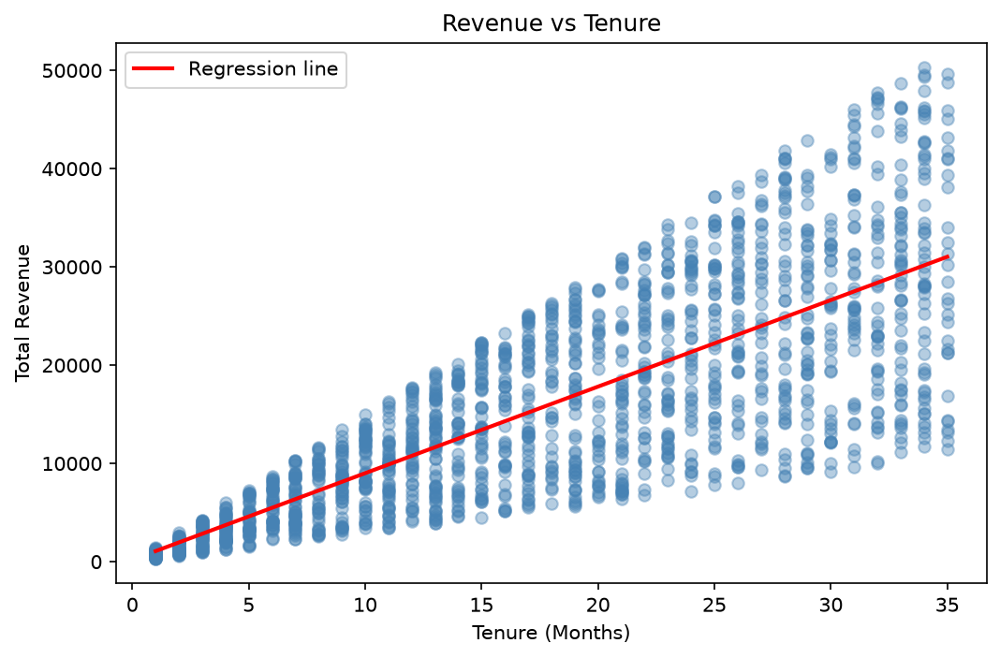
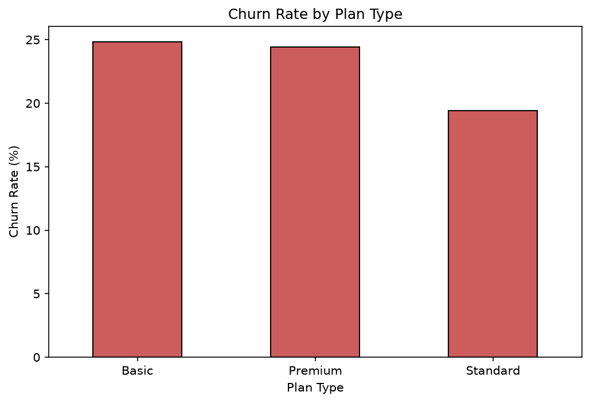
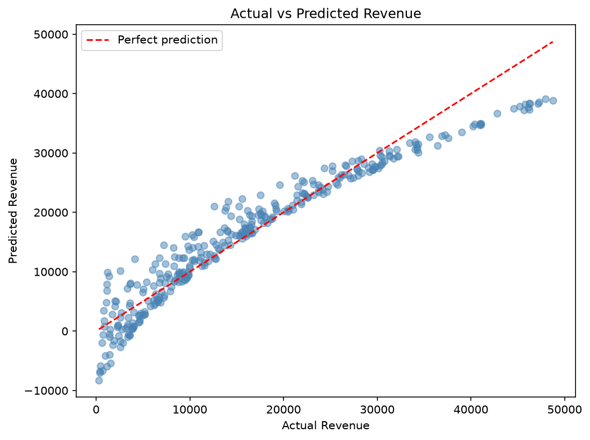

# Customer Analytics & Revenue Forecasting (Python)

An end-to-end analysis of a subscription business: cleaning the data, engineering features, visualizing customer behavior, and predicting customer revenue with Linear Regression.

## Business Problem
A subscription company wants to understand what drives revenue and churn. This project answers:
- Which customer characteristics contribute most to revenue?
- Which plans, channels and cities perform best?
- Can customer revenue be predicted reliably?

## Dataset
- 2,560 raw records, 15 columns (customer details, plan, usage, marketing channel, churn, revenue)
- 1,648 records after cleaning
- Target variable: `total_revenue`

## Tools
Python, pandas, NumPy, matplotlib, scikit-learn, Jupyter Notebook

## What I Did
1. **Data cleaning:** filled missing values (median for age and session time, "Unknown" for city, 0 for discount), removed 60 duplicates, converted dates, and removed 852 records where last active date was before signup date.
2. **Feature engineering:** created 14 features, including tenure in years, revenue per month, churn flag, age group, high-value flag, days active, session and discount categories, plan rank, and engagement score.
3. **Visualization:** created 14 charts covering distributions, plan/channel/city performance, trends over time, a correlation heatmap and model results.
4. **Modeling:** trained a Linear Regression model to predict `total_revenue` (80/20 train-test split).

## Key Findings
- **Tenure is the main revenue driver** (correlation 0.78). Each extra month adds about 880 in revenue.
- Engagement, session time, support tickets and age show almost no relationship with revenue.
- Discounts had no effect on total revenue.
- **Basic** plan brings the most total revenue because it has the most customers; average revenue per customer is similar across plans.
- **Standard** plan has the lowest churn (19.4%); Basic (24.8%) and Premium (24.4%) churn more. Overall churn is about 22.8%.
- **Email** is the best acquisition channel (6.9M revenue); **Ads** is the lowest (5.8M).

## Model Results
| Metric | Value |
|---|---|
| R² | 0.9187 |
| MAE | 2,557 |
| RMSE | 3,421 |

## Charts

## Recommendations
- Focus on customer retention, since longer tenure drives revenue.
- Investigate why Basic and Premium customers churn more than Standard.
- Shift marketing budget from Ads towards Email, Organic and Referral.
- Review discounting, as it does not increase revenue in this data.

## Limitations
- 852 records (about a third) were removed because of illogical dates.
- Revenue is almost exactly `monthly_fee × tenure_months`, so the model mostly learns that relationship.
- The monthly revenue trend uses signup month because the data has no payment dates.

## Files
- `project.ipynb`: full code
- `data/`: dataset
- `charts/`: saved visualizations
